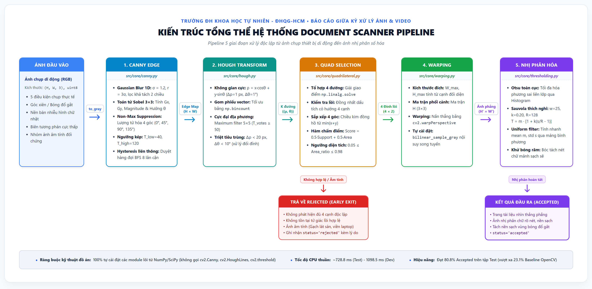

# DOCUMENT SCANNER PIPELINE: PHÁT HIỆN, HIỆU CHỈNH PHỐI CẢNH & NHỊ PHÂN HÓA TÀI LIỆU

> **Đồ án Giữa kỳ - Môn học: Nhập môn Xử lý ảnh và Video**  
> **Trường Đại học Khoa học Tự nhiên - ĐHQG-HCM**  
> **Sinh viên thực hiện:** Nguyễn Vũ Tuấn Khoa  
> **MSSV:** 23200096  
> **Báo cáo kỹ thuật chi tiết:** [Bao_cao_Giua_Ky_Document_Scanner.docx](Bao_cao_Giua_Ky_Document_Scanner.docx)

---

## 1. Giới thiệu tổng quan

Đồ án xây dựng một pipeline hoàn chỉnh tự động chuyển đổi ảnh chụp tài liệu từ thiết bị di động (ở các điều kiện phức tạp: góc xiên, bóng đổ gắt, nền bàn nhiễu hình chữ nhật, biên giấy tương phản thấp, hoặc ảnh âm tính không chứa tài liệu) thành trang giấy nhìn thẳng và ảnh nhị phân rõ nét.

### 🛡️ Ràng buộc kỹ thuật cốt lõi (Anti-Library Cheating Protocol)
Theo quy định nghiêm ngặt của đề tài và `RULE.md`, toàn bộ 5 module thuật toán lõi tại thư mục `src/core/` được **tự cài đặt 100% từ các phép toán mảng cơ bản của NumPy/SciPy**, vượt qua kiểm tra tĩnh AST (Abstract Syntax Tree), tuyệt đối không sử dụng các hàm trọn gói của OpenCV:
- **Canny:** Tự cài Gaussian 1D khả tách, Sobel 3×3, Non-Maximum Suppression (lượng tử hóa 4 hướng), phân loại ngưỡng kép và duyệt liên thông 8 bằng hàng đợi BFS (Cấm `cv2.Canny`).
- **Hough Line Transform:** Tự cài accumulator gom phiếu vector hóa bằng `np.bincount`, dò cực đại 5×5, triệt tiêu đường gần trùng (Cấm `cv2.HoughLines` / `HoughLinesP`).
- **Quadrilateral Selection:** Tự giải hệ giao điểm `np.linalg.solve`, kiểm tra tính lồi bằng tích có hướng, sắp xếp 4 góc theo chiều kim đồng hồ, tính điểm kết hợp diện tích + edge support và cơ chế Early Exit từ chối ảnh âm tính.
- **Warping:** Tự viết hàm kiểm chứng nội suy song tuyến `bilinear_sample_gray`.
- **Thresholding:** Tự cài đặt thuật toán Otsu toàn cục (tối đa hóa phương sai liên lớp từ histogram) và Sauvola cục bộ ($w=25, k=0.2, R=128$) khử bóng đổ.

---

## 2. Kiến trúc hệ thống (System Architecture)



Pipeline xử lý qua 5 giai đoạn tuần tự:
```
Ảnh chụp RGB di động (H×W×3)
       │
       ▼
[1. Canny Edge Detection] ──> Binary Edge Map (H×W)
       │
       ▼
[2. Hough Transform]      ──> Tập K đường thẳng {(ρ, θ)}
       │
       ▼
[3. Quad Selection]       ──> 4 Đỉnh lồi (4×2) [hoặc Early Exit: status='rejected']
       │
       ▼
[4. Homography & Warping] ──> Ảnh tài liệu phẳng (H'×W')
       │
       ▼
[5. Sauvola Binarization] ──> Ảnh nhị phân hoàn tất (0/255) [status='accepted']
```

---

## 3. Kết quả thực nghiệm

Toàn bộ thực nghiệm được đánh giá trên tập dữ liệu gồm **72 ảnh** (60 ảnh chụp thực tế từ sinh viên: Thẻ sinh viên, Vé xe buýt, Giấy tờ dấu đỏ, Checklist Bosch, Sổ tay Leaf, Nhóm ảnh âm tính; cùng 12 ảnh tổng hợp synthetic có ground truth chuẩn):

| Tập dữ liệu | Số ảnh | Tỷ lệ Accepted (Dương) | Tỷ lệ FPR (Ảnh âm) | CPU Time (ms) |
| :--- | :---: | :---: | :---: | :---: |
| **Development (Đề xuất)** | 42 | **33/36 (91.7%)** | 5/6 (83.3%) | 1098.5 ms |
| **Test (Đề xuất)** | 30 | **21/26 (80.8%)** | 1/4 (25.0%) | 728.8 ms |
| **Baseline Test (OpenCV Contour)** | 30 | 6/26 (23.1%) | 0/4 (0.0%) | 265.4 ms |

> **Điểm nổi bật:** Tiếp cận tích lũy bằng chứng toàn cục của Hough giúp nâng tỷ lệ phát hiện tài liệu trên tập Test từ **23.1% (OpenCV)** lên **80.8%**, đặc biệt hiệu quả trên các tài liệu mép rách hoặc hoa văn bìa sách gây đứt đoạn biên.

---

## 4. Cấu trúc thư mục

```
├── src/
│   ├── core/                  # 5 module thuật toán lõi (Tự cài đặt 100%)
│   │   ├── canny.py           # Canny Edge Detection
│   │   ├── hough.py           # Hough Line Transform
│   │   ├── quadrilateral.py   # Quadrilateral Selection
│   │   ├── warping.py         # Homography & Bilinear Warping
│   │   └── thresholding.py    # Otsu & Sauvola Binarization
│   └── baseline/
│       └── baseline.py        # Pipeline đối chứng dùng OpenCV
├── tests/                     # 30 ca unit test kiểm thử biên cho 5 module lõi
├── data/                      # File manifest CSV và tập ảnh thực nghiệm
├── outputs/
│   ├── figures/               # Sơ đồ kiến trúc và ảnh trực quan báo cáo
│   └── *.csv                  # 100% dữ liệu đo kiểm thực nghiệm thật
├── scripts/                   # Script chạy kiểm thử, sinh đồ thị và tạo báo cáo docx
├── docs/                      # Giao diện HTML sơ đồ kiến trúc tương tác
├── run_pipeline.py            # Entrypoint chạy batch pipeline
├── RULE.md                    # Quy chuẩn đồ án và luật kiểm duyệt AI
└── Bao_cao_Giua_Ky_Document_Scanner.docx # File báo cáo chính thức hoàn chỉnh
```

---

## 5. Hướng dẫn chạy và Tái lập kết quả

### Cài đặt môi trường
Yêu cầu Python 3.10+ trở lên:
```bash
pip install -r requirements.txt
# hoặc: pip install numpy scipy opencv-python matplotlib python-docx pytest
```

### Chạy Unit Test kiểm thử biên (30 tests)
```bash
pytest tests/ -v
```

### Quét kiểm tra tĩnh AST chống hàm thư viện cấm
```bash
python tests/verify_ast.py src/core/canny.py
python tests/verify_ast.py src/core/hough.py
python tests/verify_ast.py src/core/quadrilateral.py
python tests/verify_ast.py src/core/warping.py
python tests/verify_ast.py src/core/thresholding.py
```

### Chạy pipeline trên tập dữ liệu
```bash
# Tập Development
python run_pipeline.py --manifest data/manifest_development_full.csv --images-dir data/development --output-csv outputs/results_development.csv

# Tập Test
python run_pipeline.py --manifest data/manifest_test_full.csv --images-dir data/test --output-csv outputs/results_test.csv
```

### Sinh lại file Báo cáo kỹ thuật Word (.docx)
```bash
python scripts/build_full_report_docx.py
```
